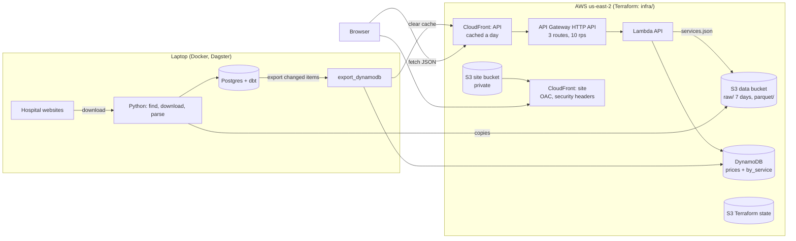

# 03 · Cloud and serving layer

Phase 3 puts precomputed answers in DynamoDB behind a Lambda API, with a React site, all defined in Terraform. Postgres stays the system of record; DynamoDB only holds what the site reads.

## Architecture



| Piece | Where | Defined in |
| --- | --- | --- |
| Download, parse, warehouse, export | Laptop, scheduled by Dagster (Mondays) | `ingest/`, `warehouse/`, `serving/`, `orchestration/` |
| Raw and Parquet copies, `services.json` | S3 data bucket | `infra/main/data_bucket.tf` |
| Serving table | DynamoDB | `infra/main/dynamodb.tf` |
| API | Lambda + API Gateway + CloudFront | `api/handler.py`, `infra/main/api.tf`, `cloudfront.tf` |
| Site | S3 + CloudFront | `web/`, `infra/main/site.tf` |
| Terraform state, deploy role | S3 (state bucket) | `infra/bootstrap/` |

## DynamoDB key design

Written before any code, because in DynamoDB the keys are the queries: it fetches by key fast and does nothing else well (no joins, no ad-hoc filters, no text search). So the design starts from the questions the site asks.

### Decisions

- **All of Arizona**, all 13,243 services, with every plan's price. (Pima County stays the headline in the write-ups.)
- **One item per hospital × service**, not per price row: 338,697 items instead of 14.6M. DynamoDB bills per write, so this is about $2 for a full export instead of about $18, and the site always shows a hospital's prices for a service together anyway.
- **Hospitals are keyed by CCN**, not NPI: CCN is the project's hospital id everywhere else, and one hospital has up to dozens of NPIs.
- **On-demand capacity**: no capacity planning, pay per request, and the traffic is tiny.

### Access patterns

| Question | Endpoint | How it's answered |
| --- | --- | --- |
| Find a service ("knee mri") | `GET /services?q=` | Not DynamoDB. The service list (code, description, shoppable flag; about 1 MB) is a static JSON file served by CloudFront and searched in the browser. |
| Compare hospitals for one service | `GET /services/{code}/prices?payer=` | One `Query` on the index `by_service`: `GSI1PK = SERVICE#<code>`, every hospital that prices it (up to 69). The payer filter is applied in the Lambda. Hospital names and scores come from one `BatchGetItem` of the `PROFILE` items. |
| One hospital | `GET /providers/{ccn}` | `GetItem` of `HOSPITAL#<ccn>` / `PROFILE`: name, address, compliance score and rule results, and a summary of its CMS shoppable services. Its full service list pages through `Query PK = HOSPITAL#<ccn>, SK begins_with SERVICE#`. |
| One hospital, one service | (used by both pages) | `GetItem` of `HOSPITAL#<ccn>` / `SERVICE#<code>`. |

### Items

| Item | PK | SK | GSI1PK | GSI1SK | Attributes |
| --- | --- | --- | --- | --- | --- |
| Hospital × service | `HOSPITAL#<ccn>` | `SERVICE#<code>` | `SERVICE#<code>` | `HOSPITAL#<ccn>` | description, cash and gross prices, `prices`: one entry per payer × plan × setting × price type with payer group, market, methodology, median amount and row count; `content_hash` |
| Hospital profile | `HOSPITAL#<ccn>` | `PROFILE` | — | — | name, city, county, type, compliance score and rules, shoppable-service summary, `content_hash` |

`<code>` is the warehouse `service_key` (e.g. `CPT/HCPCS:73721`). Profile items leave the GSI keys out, so they don't appear in the index (a *sparse* index).

**Why a GSI rather than writing each item twice.** The two price questions read the same item from two directions (hospital first, or service first). A global secondary index is a copy of the table that DynamoDB keeps in sync under different keys, so the exporter writes each item once. It costs the same writes as a second copy would, but there's no way for the two copies to disagree. The index projects all attributes, because the compare page needs the prices.

**Why names and scores aren't copied into every price item.** A hospital's score changes when its file changes, and copying it into its ~5,000 price items would mean rewriting all of them. One `BatchGetItem` of up to 69 profiles per compare request is cheaper.

### Sizes (measured 2026-10-16)

The design estimate used one-letter field names; the built items use readable ones (`payer`, `plan`, `market`, ...) and carry algorithm text, so they came out bigger:

| | Estimate | Built |
| --- | ---: | ---: |
| Hospital × service items | 338,697 | 338,697 (+ 95 profiles) |
| Average item, as DynamoDB counts it (nulls dropped) | 4.7 KB | 5.8 KB |
| 99th percentile (JSON) | 16 KB | 30 KB |
| Largest (JSON) | 134 KB | 240 KB |
| Total JSON | 1.6 GB | 2.8 GB |

The item limit is 400 KB; a dbt test fails any item over 350 KB, and the exporter refuses one rather than truncating it. A compare query reads up to 69 items, about 400 KB on average, under the 1 MB `Query` page limit, so most compare requests take one page.

### Cost

On-demand writes cost one write unit per KB, and the index costs the same again. A full export is about 4.3M write units, roughly $2.70 (estimated at $2 before the items were built). Storage is inside the 25 GB free tier.

To keep weekly runs near zero, the export is idempotent and incremental. Each item's JSON is built deterministically and hashed. The exporter keeps the last exported hash per key in Postgres, writes only items whose hash changed, and deletes items that are no longer produced. A rerun with the same input writes nothing.

### Not in DynamoDB

- **Pipeline state** (the plan's `FILE#<checksum>` pattern): already in Postgres `raw.source_files` and in Dagster, so it isn't duplicated here.
- **Statewide and national statistics:** `marts.price_summary` stays in Postgres; the site shows per-hospital prices.

## Terraform

Two stacks, both in `infra/`:

- **`bootstrap/`**: the S3 bucket that stores Terraform state: versioned (every state write kept, old versions expire after 90 days), encrypted with S3-managed keys, public access blocked, HTTPS only, and protected from `destroy`. Its first apply had to use local state, since a backend can't live in a bucket that doesn't exist yet; its state was then moved into the bucket it created (`bootstrap/terraform.tfstate`) with `terraform init -migrate-state`, so no state lives only on one machine. Tearing it down means moving the state back to local first.
- **`main/`**: everything else. It keeps its state in that bucket, locked with S3's native lock file (`use_lockfile`, Terraform 1.10+), which replaces the DynamoDB lock table older setups needed. `default_tags` on the provider tags every resource `Project = az-price-transparency`, so the project's resources and costs can be found and torn down together.

Changes are applied only from a saved plan that has been read first:

```
$env:AWS_PROFILE = "az-price"
cd infra/main
terraform init '-backend-config=backend.hcl'     # copy backend.hcl.example (bootstrap uses ../main/backend.hcl); quotes needed in PowerShell 5.1
terraform plan '-out=main.tfplan'
terraform apply main.tfplan
```

CI checks formatting and validates both stacks on every push, without AWS credentials.

Teardown was tested early, on the data bucket: apply, destroy (bucket confirmed gone), apply, then a plan showing no drift.

## Data bucket

`az-price-transparency-data-<account id>` (`infra/main/data_bucket.tf`): public access blocked, S3-managed encryption, HTTPS only. Its contents can all be rebuilt, so it has no versioning and `force_destroy` lets `terraform destroy` remove it.

| Prefix | What | Kept |
| --- | --- | --- |
| `raw/<yyyy-mm-dd>/` | Price files as downloaded, gzip-compressed | 7 days (lifecycle rule); the hospitals' sites are the long-term copy |
| `parquet/` | Parsed prices, one file per hospital | Until replaced |

The pipeline writes to local disk as before (the parser and loader read it) and, when `DATA_BUCKET` is set, copies each new raw file and each Parquet file to the bucket (`ingest/storage.py`). The raw file's S3 location is recorded in `raw.source_files.s3_uri`. A failed upload is reported but never fails the download or parse. Without `DATA_BUCKET`, as in tests and CI, nothing is uploaded.

```
$env:AWS_PROFILE = "az-price"
$env:DATA_BUCKET = "az-price-transparency-data-<account id>"   # terraform -chdir=infra/main output data_bucket
uv run dagster dev -m orchestration.definitions
```

`aws login` credentials need botocore's CRT extension, so the dependency is `boto3[crt]`.

## DynamoDB table

`az-price-transparency-prices` (`infra/main/dynamodb.tf`): on-demand, with the `by_service` index, as designed above. No point-in-time recovery (billed per GB; the export rebuilds it) and no deletion protection, so `terraform destroy` still removes everything. First export 2026-10-16: 338,792 items in 51 minutes (one writer thread; parallel writers would cut that if it matters), and an unchanged rerun wrote nothing in 2 seconds. Spot-checked against Postgres: Tucson Medical Center's outpatient Aetna knee MRI price matches, and 56 hospitals price a knee MRI in both.

## Export to DynamoDB

- **dbt shapes the items** (`warehouse/models/serving/`): `srv_hospital_service_items` (one row per hospital × service: prices per payer × plan × setting × price type, with parent company, market, most common methodology, median amount and row count; plus the non-insurer gross, cash, min and max prices) and `srv_hospital_profiles` (one per in-scope hospital, including those with no usable prices). Each row carries its item as JSON built in a fixed order, its `content_hash` and its size. Postgres builds all 338K items in about five minutes.
- **`serving/export_dynamodb.py` writes them:** new and changed items (by hash, against `raw.dynamodb_export_state`) in batches, deletes items no longer produced, and records each chunk only after DynamoDB has accepted it, so an interrupted export resumes and an unchanged rerun writes nothing. `--dry-run` counts without writing.
- **Dagster:** the `dynamodb_items` asset, in its own `export_serving` job (Mondays 13:00), so the warehouse still builds without AWS.

```
$env:AWS_PROFILE = "az-price"; $env:PRICES_TABLE = "az-price-transparency-prices"
uv run python -m serving.export_dynamodb --dry-run
uv run python -m serving.export_dynamodb
```

## API

`api/handler.py` on Lambda (Python 3.13, ARM, 1024 MB) behind an API Gateway HTTP API (`infra/main/api.tf`), at the URL in `terraform -chdir=infra/main output api_url`:

| Endpoint | Reads |
| --- | --- |
| `GET /services?q=knee mri` | `serving/services.json` in the data bucket, loaded once per cold start |
| `GET /services/{id}/prices?payer=&market=` | `Query` on `by_service`, then `BatchGetItem` of the hospitals' profiles |
| `GET /providers/{ccn}` | `GetItem` of the hospital's `PROFILE` |

- **Least privilege:** the Lambda's role can read the table, its index and `services.json`, and write its own logs; nothing else.
- **Cost guards:** only the three routes exist (anything else is a 404 from API Gateway without invoking the Lambda), and the stage is throttled to 10 requests a second (bursts of 20). The account allows 10 concurrent Lambdas.
- **Plain-English search:** hospital and CMS descriptions use billing language ("MRI EXT LOWER JT"), so `warehouse/seeds/service_search_terms.csv` adds words people search with ("knee", "doctor visit") to matching services. 908 of 13,243 services get terms. It is a reviewed seed, like the payer patterns.

Measured 2026-10-16 (compare = every hospital's knee MRI prices, 56 hospitals):

| | Lambda time | Total from Tucson | Response |
| --- | ---: | ---: | ---: |
| 256 MB | 1,320 ms | 2.0 s | 616 KB |
| 1024 MB | 265 ms | 1.0 s | 616 KB |
| 1024 MB + gzip | ~270 ms | 0.63 s | 36 KB |

CPU scales with Lambda memory, and decoding ~400 KB of DynamoDB items is CPU-bound (it used 125 MB either way). API Gateway HTTP APIs don't compress, so the handler gzips when the client accepts it. Search and profile requests take 2–30 ms in the Lambda.

## CloudFront

A CloudFront distribution (`infra/main/cloudfront.tf`) sits in front of the API. Its cache key is the path plus `q`, `payer` and `market` only, so other query parameters can't bypass the cache. The handler sends `Cache-Control: public, max-age=300, s-maxage=86400`: CloudFront keeps an answer a day, browsers five minutes. After an export that changed anything, the exporter (and the Dagster asset) clears the cache with one `/*` invalidation when `CLOUDFRONT_DISTRIBUTION_ID` is set; tested once by hand: the invalidation completed and the next request was a miss.

Measured 2026-10-16 from Tucson, medians of five requests, gzip on:

| Request | API Gateway directly | CloudFront, first (miss) | CloudFront, repeat (hit) |
| --- | ---: | ---: | ---: |
| Search: `knee mri` | 0.31 s | 0.39 s | 0.10 s |
| Compare: knee MRI at 56 hospitals | 0.65 s | 0.65 s | 0.11 s |
| Hospital profile | 0.30 s | 0.31 s | 0.10 s |

A hit never invokes the Lambda or reads DynamoDB, so repeat questions cost CloudFront's per-request price only (inside its free tier at this traffic). Price class 100 (North American and European edges) is the cheapest.

## Site

`web/`: Vite, React and TypeScript, one page (72 KB gzipped). Search for a service, pick one, and get every hospital's prices for it: insurer median and range, cash price, list price and the hospital's compliance badge, cheapest insurer median first. Filters for area (Pima County by default), setting, insurance type and insurer or plan; they work in the browser on one cached API response, so every filter choice is served by the same CloudFront hit. A row expands to every plan's price, the hospital's address, the rules it fails and a link to its own price file. The page state is in the URL, so a filtered view can be shared. "Published prices, not quotes" is under the table and in the footer.

Hosting (`infra/main/site.tf`): a private bucket readable only by its CloudFront distribution (Origin Access Control; direct S3 requests get 403), with security headers on every response, including a content security policy that allows scripts and styles only from the site and data only from the API. `scripts/deploy_site.py` uploads the build: hashed files under `assets/` are cached for a year, `index.html` never, so only `index.html` is cleared from CloudFront and a deploy shows at once.

```
cd web; npm ci; npm test; npm run build; cd ..
uv run python scripts/deploy_site.py
```

**CORS.** API Gateway's CORS setting adds `Access-Control-Allow-Origin` only to requests that carry an `Origin` header, and CloudFront caches one copy for everyone, so a copy cached from a non-browser request would break the site. The handler sends the header on every response instead, and the API's cache was cleared once after the change.

Checked in headless Edge against the live API at desktop width and inside a 390 px frame (desktop Edge won't make a window narrower than about 500 px), and with filters from a shared link.

## Blocked: GitHub Actions to AWS (OIDC)

The deploy role is written (local branch `oidc-blocked`: `infra/bootstrap/github_oidc.tf` and `.github/workflows/deploy.yml`) but can't be applied: a service control policy in the AWS Organization this account belongs to denies every IAM OpenID Connect provider action, even listing them. It has to be changed from the organization's management account. Until then, Terraform is applied from a laptop.

## IAM

Every role can do only what its job needs; each permission is commented with why in the Terraform.

| Who | Role | Can |
| --- | --- | --- |
| You, applying Terraform and running the pipeline from a laptop | `AccountFullAccessRole` via `aws login` | Everything in the account (subject to the organization's policies). Changes go through a saved plan that is read before `apply`. |
| The API Lambda | `az-price-transparency-api` | `GetItem`, `Query`, `BatchGetItem` on the prices table and its `by_service` index; `GetObject` on `serving/services.json` only; write to its own log group. Nothing else: no writes, no other buckets. |
| CloudFront (site) | none: a bucket policy | Read objects in the site bucket, only for requests signed by the site distribution (`AWS:SourceArn`); everyone else gets 403. |
| API Gateway | none: a Lambda permission | Invoke the API Lambda, only from this API. |
| GitHub Actions (blocked, see above) | `az-price-transparency-github-deploy` | Jobs in the repo's `production` environment (which accepts only `main`) may assume it. For now it can read and write `main/` in the state bucket and nothing more; each resource CI deploys will add its own statement. It can't touch `bootstrap/`, so CI can't change its own permissions. |

Every bucket blocks public access, refuses non-HTTPS requests and has ACLs turned off.

## Caching

| Layer | What | Kept | Cleared by |
| --- | --- | --- | --- |
| CloudFront, API | Each answer, keyed by path + `q`, `payer`, `market` | 1 day (`s-maxage`) | The export, after any change (one `/*` invalidation) |
| Browser, API | Each answer | 5 minutes (`max-age`) | Expiry |
| Lambda | `services.json` | The life of a Lambda instance | A new instance (a deploy, or idle for a while) |
| CloudFront and browser, site | Hashed files under `assets/` | 1 year (`immutable`) | Never needed: a new build has new names |
| CloudFront and browser, site | `index.html` | Not cached | — |

DynamoDB itself needs no cache in front of it (single-digit-millisecond reads); CloudFront is there for distance to the viewer and so the same answer is never computed twice.

## Monthly cost

Estimated from measured usage and AWS's published us-east-2 prices (October 2026). The bill itself is in the AWS console under Billing; the account is on the Free plan, so charges come out of its credits.

| Service | Usage | Price | Cost |
| --- | --- | --- | ---: |
| DynamoDB storage | 1.9 GB table + 1.9 GB index | 25 GB free | $0 |
| DynamoDB writes, first export (one-time) | ~4.3M write units | $0.625 per million | ~$2.70 |
| DynamoDB writes, weekly export | Only changed items: ~0.4M units if a tenth change | $0.625 per million | ~$1/month |
| DynamoDB reads | ~60 read units per uncached compare | $0.125 per million | ~$0 |
| S3 | 52 MB data, 1.3 MB site, 79 KB state | $0.023 per GB-month | <$0.01 |
| Lambda | Only cache misses; ~0.3 s at 1 GB each | 1M requests and 400K GB-s a month free | $0 |
| API Gateway HTTP API | Only cache misses | $1.00 per million requests | ~$0 |
| CloudFront (both) | All requests | 1 TB and 10M requests a month free | $0 |
| CloudWatch Logs | A few KB per request, kept 14 days | $0.50 per GB ingested | ~$0 |
| **Total** | | | **~$1/month** after the one-time ~$2.70 |

The one cost that can grow is DynamoDB writes: if a week's files changed every item, the export would rewrite all of them (~$2.70 that week). The API's throttling (10 requests a second) and CloudFront's free tier bound what traffic can cost.
