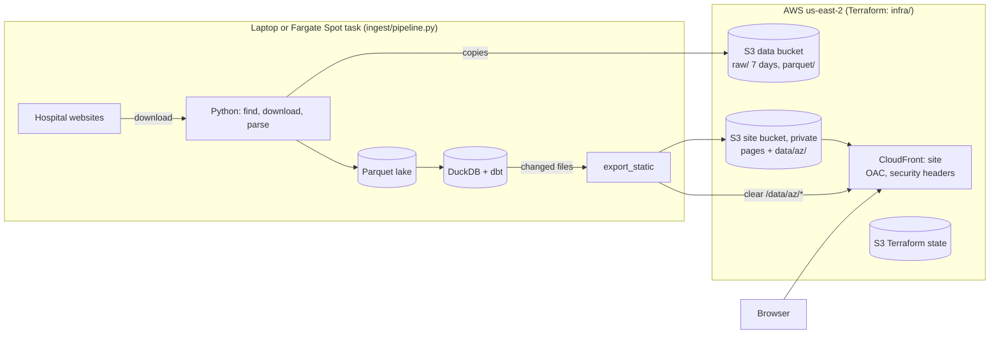

# 03 · Cloud and serving layer

Phase 3 put precomputed answers in DynamoDB behind a Lambda API, with a React site, all defined in Terraform. In October 2026 the API and DynamoDB were replaced by static JSON files served with the site, the first step toward a version for every state at a few dollars a month. The same month Postgres was replaced by a Parquet lake and a DuckDB warehouse (below), and the pipeline was packaged to run in the cloud on Fargate Spot.

## Architecture



| Piece | Where | Defined in |
| --- | --- | --- |
| Download, parse, warehouse, export | Laptop (Dagster, schedules off), or a Fargate Spot task for whole states | `ingest/`, `warehouse/`, `serving/`, `orchestration/`, `infra/main/pipeline_run.tf` |
| Parquet lake | `data/lake` locally; `lake/` in the data bucket in the cloud | `ingest/lake.py` |
| Raw and Parquet copies | S3 data bucket | `infra/main/data_bucket.tf` |
| Site and its data files | S3 + CloudFront, one domain | `web/`, `serving/export_static.py`, `infra/main/site.tf` |
| Terraform state, deploy role | S3 (state bucket) | `infra/bootstrap/` |

## Warehouse: a Parquet lake and DuckDB

Until October 2026 the raw tables were in Postgres (3.7 GB of hospital prices, 2.1 GB of insurer rates for Arizona). At every state that would be a server holding roughly 60 times as much, running all the time. Now:

- **The lake** (`ingest/lake.py`): every raw table is Parquet files, a folder per hospital (`raw/hospital_charges/state=AZ/ccn=030006/`), per insurer network, and one file per download run, compliance run and so on. The same Arizona rows are 75 MB (51 MB hospital, 24 MB insurer). A writer replaces a hospital's folder whole, so a rerun never leaves half of one. `LAKE` is a folder or an S3 prefix; the code is the same.
- **The warehouse** is a DuckDB file built by dbt (`dbt-duckdb`) from views over the lake, created when a run starts. Nothing runs between builds. A full Arizona build takes about 6 minutes with DuckDB capped at 6 GB (`DUCKDB_MEMORY`); past the cap it spills to disk.
- **Same answers:** the site's 13,339 files built from DuckDB were compared with the live ones built from Postgres: 13,237 identical, and the other 102 pick a different one of two tied values (a service's most common description or a price's methodology; Postgres sorts text by locale, DuckDB by bytes). Medians are rounded as decimals, as Postgres did, not as doubles (16499.975 is 16499.97499... as a double).
- **Changes for DuckDB:** small macros for Postgres-only functions (`~*`, `initcap`), JSON built with DuckDB's functions, and `srv_service_prices`, a long table of each hospital's prices per service, from which `export_static.py` assembles each service's file. Building every file's JSON in SQL needed more memory than DuckDB could spill.

## Hospital pipeline on Fargate Spot

`ingest/pipeline.py` runs whole states in one process: for each in-scope hospital with a price file URL it downloads, parses and writes to the lake, then deletes the local copies (the raw file is kept in the data bucket for 7 days), so the disk holds only files in progress. Then compliance checks, payer plans, dbt build and each state's site files. Four worker processes; files over 1 GB are parsed afterwards one at a time, each in a fresh process, so one that runs out of memory fails alone. A file refused with a 403 is retried in headless Chromium.

`infra/main/pipeline_run.tf` (written October 2026, **not yet applied**): an image (`docker/pipeline.Dockerfile`, x86-64, since Fargate Spot doesn't run ARM64), a 4 vCPU / 30 GB task with 100 GB of disk, roles limited to the lake, the raw copies and the site's `data/` files, and a weekly schedule created **disabled**. A run is started by hand with the `pipeline_run_command` output.

- **Spot:** billed per second at well below on-demand, but AWS can stop the task with two minutes' notice. The download log and parse results are saved every 25 hospitals and on the stop signal, and a rerun skips hospitals downloaded in the last 7 days whose rows are in the lake.
- **Trial:** 6 Utah hospitals on the laptop with two workers (`--limit`, a scratch lake): 6 downloaded and parsed (4 MB to 729 MB files, 0.4 to 1.7 million prices each) in under a minute, and the rerun skipped the 3 already done.
- **Memory:** parsing Arizona's largest files (0.5 GB) peaks at 2.8 to 3.4 GB each.

## Static data files

Every answer the API gave is precomputed as a file, so the site is static end to end: `serving/export_static.py` reads the same dbt serving models and writes, gzip-compressed, under `data/<state>/` in the site bucket:

| File | What | Arizona |
| --- | --- | --- |
| `services/<slug>.json` (`cpt-73721`, `drg-470`) | Every hospital's prices for one service: what `GET /services/{id}/prices` returned | 13,243 files |
| `providers/<ccn>.json` | One hospital: score, rules, shoppable prices | 95 |
| `search.json` | The service list with plain-English terms; the browser searches it | 1 (about 350 KB compressed) |

- **Why:** reads were already all of the same precomputed answers, cached by CloudFront. Files cost S3 storage only (127 MB for Arizona, against 1.9 GB of DynamoDB items), need no Lambda or API Gateway, and scale to every state by adding a folder: a state's files are fetched only by that state's pages, so no file grows with the country.
- **Same answers:** checked byte for byte (as parsed JSON) against the API for a service and a hospital before switching.
- **Only what changed:** each file is gzipped without a timestamp, so equal data gives equal bytes, and S3's ETag (the MD5 of a single-part upload) tells whether a file changed. Unchanged files aren't uploaded, removed ones are deleted, and `/data/<state>/*` is cleared from CloudFront after any change. The first upload took 3 minutes with 16 threads.
- **Missing files:** CloudFront answers an unknown path with the app shell (so pages that weren't pre-rendered work), so the site treats a non-JSON answer as not found.
- **Dagster:** the `static_data_files` asset, in the `export_serving` job (Mondays 13:00). The site deploy never deletes `data/`.

```
$env:SITE_BUCKET = terraform -chdir=infra/main output -raw site_bucket
$env:SITE_DISTRIBUTION_ID = terraform -chdir=infra/main output -raw site_distribution_id
uv run python -m serving.export_static --dry-run
uv run python -m serving.export_static
```

The retired API, DynamoDB table and API CloudFront were removed with Terraform (14 resources), after the site had run on the files.

## DynamoDB key design

> **Retired in October 2026**, replaced by [static data files](#static-data-files). Kept as a record of the design.

Written before any code, because in DynamoDB the keys are the queries: it fetches by key fast and does nothing else well (no joins, no ad-hoc filters, no text search). So the design starts from the questions the site asks.

### Decisions

- **All of Arizona**, all 13,243 services, with every plan's price. (Pima County stays the headline in the write-ups.)
- **One item per hospital × service**, not per price row: 338,697 items instead of 14.6M. DynamoDB bills per write, so this is about $2 for a full export instead of about $18, and the site always shows a hospital's prices for a service together anyway.
- **Hospitals are keyed by CCN**, not NPI: CCN is the project's hospital id everywhere else, and one hospital has up to dozens of NPIs.
- **On-demand capacity**: no capacity planning, pay per request, and the traffic is tiny.

### Access patterns

| Question | Endpoint | How it's answered |
| --- | --- | --- |
| Find a service ("knee mri") | `GET /services?q=` | Not DynamoDB. The service list (code, description, shoppable flag; about 1 MB) is a static JSON file served by CloudFront and searched in the browser. |
| Compare hospitals for one service | `GET /services/{code}/prices?payer=` | One `Query` on the index `by_service`: `GSI1PK = SERVICE#<code>`, every hospital that prices it (up to 69). The payer filter is applied in the Lambda. Hospital names and scores come from one `BatchGetItem` of the `PROFILE` items. |
| One hospital | `GET /providers/{ccn}` | `GetItem` of `HOSPITAL#<ccn>` / `PROFILE`: name, address, compliance score and rule results, and a summary of its CMS shoppable services. Its full service list pages through `Query PK = HOSPITAL#<ccn>, SK begins_with SERVICE#`. |
| One hospital, one service | (used by both pages) | `GetItem` of `HOSPITAL#<ccn>` / `SERVICE#<code>`. |

### Items

| Item | PK | SK | GSI1PK | GSI1SK | Attributes |
| --- | --- | --- | --- | --- | --- |
| Hospital × service | `HOSPITAL#<ccn>` | `SERVICE#<code>` | `SERVICE#<code>` | `HOSPITAL#<ccn>` | description, cash and gross prices, `prices`: one entry per payer × plan × setting × price type with payer group, market, methodology, median amount and row count; `content_hash` |
| Hospital profile | `HOSPITAL#<ccn>` | `PROFILE` | — | — | name, city, county, type, compliance score and rules, shoppable-service summary, `content_hash` |

`<code>` is the warehouse `service_key` (e.g. `CPT/HCPCS:73721`). Profile items leave the GSI keys out, so they don't appear in the index (a *sparse* index).

**Why a GSI rather than writing each item twice.** The two price questions read the same item from two directions (hospital first, or service first). A global secondary index is a copy of the table that DynamoDB keeps in sync under different keys, so the exporter writes each item once. It costs the same writes as a second copy would, but there's no way for the two copies to disagree. The index projects all attributes, because the compare page needs the prices.

**Why names and scores aren't copied into every price item.** A hospital's score changes when its file changes, and copying it into its ~5,000 price items would mean rewriting all of them. One `BatchGetItem` of up to 69 profiles per compare request is cheaper.

### Sizes (measured 2026-10-16)

The design estimate used one-letter field names; the built items use readable ones (`payer`, `plan`, `market`, ...) and carry algorithm text, so they came out bigger:

| | Estimate | Built |
| --- | ---: | ---: |
| Hospital × service items | 338,697 | 338,697 (+ 95 profiles) |
| Average item, as DynamoDB counts it (nulls dropped) | 4.7 KB | 5.8 KB |
| 99th percentile (JSON) | 16 KB | 30 KB |
| Largest (JSON) | 134 KB | 240 KB |
| Total JSON | 1.6 GB | 2.8 GB |

The item limit is 400 KB; a dbt test fails any item over 350 KB, and the exporter refuses one rather than truncating it. A compare query reads up to 69 items, about 400 KB on average, under the 1 MB `Query` page limit, so most compare requests take one page.

### Cost

On-demand writes cost one write unit per KB, and the index costs the same again. A full export is about 4.3M write units, roughly $2.70 (estimated at $2 before the items were built). Storage is inside the 25 GB free tier.

To keep weekly runs near zero, the export is idempotent and incremental. Each item's JSON is built deterministically and hashed. The exporter keeps the last exported hash per key in Postgres, writes only items whose hash changed, and deletes items that are no longer produced. A rerun with the same input writes nothing.

### Not in DynamoDB

- **Pipeline state** (the plan's `FILE#<checksum>` pattern): already in Postgres `raw.source_files` and in Dagster, so it isn't duplicated here.
- **Statewide and national statistics:** `marts.price_summary` stays in Postgres; the site shows per-hospital prices.

## Terraform

Two stacks, both in `infra/`:

- **`bootstrap/`**: the S3 bucket that stores Terraform state: versioned (every state write kept, old versions expire after 90 days), encrypted with S3-managed keys, public access blocked, HTTPS only, and protected from `destroy`. Its first apply had to use local state, since a backend can't live in a bucket that doesn't exist yet; its state was then moved into the bucket it created (`bootstrap/terraform.tfstate`) with `terraform init -migrate-state`, so no state lives only on one machine. Tearing it down means moving the state back to local first.
- **`main/`**: everything else. It keeps its state in that bucket, locked with S3's native lock file (`use_lockfile`, Terraform 1.10+), which replaces the DynamoDB lock table older setups needed. `default_tags` on the provider tags every resource `Project = az-price-transparency`, so the project's resources and costs can be found and torn down together.

Changes are applied only from a saved plan that has been read first:

```
$env:AWS_PROFILE = "az-price"
cd infra/main
terraform init '-backend-config=backend.hcl'     # copy backend.hcl.example (bootstrap uses ../main/backend.hcl); quotes needed in PowerShell 5.1
terraform plan '-out=main.tfplan'
terraform apply main.tfplan
```

CI checks formatting and validates both stacks on every push, without AWS credentials.

Teardown was tested early, on the data bucket: apply, destroy (bucket confirmed gone), apply, then a plan showing no drift.

## Data bucket

`az-price-transparency-data-<account id>` (`infra/main/data_bucket.tf`): public access blocked, S3-managed encryption, HTTPS only. Its contents can all be rebuilt, so it has no versioning and `force_destroy` lets `terraform destroy` remove it.

| Prefix | What | Kept |
| --- | --- | --- |
| `raw/<yyyy-mm-dd>/` | Price files as downloaded, gzip-compressed | 7 days (lifecycle rule); the hospitals' sites are the long-term copy |
| `parquet/` | Parsed prices, one file per hospital | Until replaced |

The pipeline writes to local disk as before (the parser and loader read it) and, when `DATA_BUCKET` is set, copies each new raw file and each Parquet file to the bucket (`ingest/storage.py`). The raw file's S3 location is recorded in `raw.source_files.s3_uri`. A failed upload is reported but never fails the download or parse. Without `DATA_BUCKET`, as in tests and CI, nothing is uploaded.

```
$env:AWS_PROFILE = "az-price"
$env:DATA_BUCKET = "az-price-transparency-data-<account id>"   # terraform -chdir=infra/main output data_bucket
uv run dagster dev -m orchestration.definitions
```

`aws login` credentials need botocore's CRT extension, so the dependency is `boto3[crt]`.

## DynamoDB table

> **Retired in October 2026**, replaced by [static data files](#static-data-files). Kept as a record of the design.

`az-price-transparency-prices` (`infra/main/dynamodb.tf`): on-demand, with the `by_service` index, as designed above. No point-in-time recovery (billed per GB; the export rebuilds it) and no deletion protection, so `terraform destroy` still removes everything. First export 2026-10-16: 338,792 items in 51 minutes (one writer thread; parallel writers would cut that if it matters), and an unchanged rerun wrote nothing in 2 seconds. Spot-checked against Postgres: Tucson Medical Center's outpatient Aetna knee MRI price matches, and 56 hospitals price a knee MRI in both.

## Export to DynamoDB

> **Retired in October 2026**, replaced by [static data files](#static-data-files). Kept as a record of the design.

- **dbt shapes the items** (`warehouse/models/serving/`): `srv_hospital_service_items` (one row per hospital × service: prices per payer × plan × setting × price type, with parent company, market, most common methodology, median amount and row count; plus the non-insurer gross, cash, min and max prices) and `srv_hospital_profiles` (one per in-scope hospital, including those with no usable prices). Each row carries its item as JSON built in a fixed order, its `content_hash` and its size. Postgres builds all 338K items in about five minutes.
- **`serving/export_dynamodb.py` writes them:** new and changed items (by hash, against `raw.dynamodb_export_state`) in batches, deletes items no longer produced, and records each chunk only after DynamoDB has accepted it, so an interrupted export resumes and an unchanged rerun writes nothing. `--dry-run` counts without writing.
- **Dagster:** the `dynamodb_items` asset, in its own `export_serving` job (Mondays 13:00), so the warehouse still builds without AWS.

```
$env:AWS_PROFILE = "az-price"; $env:PRICES_TABLE = "az-price-transparency-prices"
uv run python -m serving.export_dynamodb --dry-run
uv run python -m serving.export_dynamodb
```

## API

> **Retired in October 2026**, replaced by [static data files](#static-data-files). Kept as a record of the design.

`api/handler.py` on Lambda (Python 3.13, ARM, 1024 MB) behind an API Gateway HTTP API (`infra/main/api.tf`), at the URL in `terraform -chdir=infra/main output api_url`:

| Endpoint | Reads |
| --- | --- |
| `GET /services?q=knee mri` | `serving/services.json` in the data bucket, loaded once per cold start |
| `GET /services/{id}/prices?payer=&market=` | `Query` on `by_service`, then `BatchGetItem` of the hospitals' profiles |
| `GET /providers/{ccn}` | `GetItem` of the hospital's `PROFILE` |

- **Least privilege:** the Lambda's role can read the table, its index and `services.json`, and write its own logs; nothing else.
- **Cost guards:** only the three routes exist (anything else is a 404 from API Gateway without invoking the Lambda), and the stage is throttled to 10 requests a second (bursts of 20). The account allows 10 concurrent Lambdas.
- **Plain-English search:** hospital and CMS descriptions use billing language ("MRI EXT LOWER JT"), so `warehouse/seeds/service_search_terms.csv` adds words people search with ("knee", "doctor visit") to matching services. 908 of 13,243 services get terms. It is a reviewed seed, like the payer patterns.

Measured 2026-10-16 (compare = every hospital's knee MRI prices, 56 hospitals):

| | Lambda time | Total from Tucson | Response |
| --- | ---: | ---: | ---: |
| 256 MB | 1,320 ms | 2.0 s | 616 KB |
| 1024 MB | 265 ms | 1.0 s | 616 KB |
| 1024 MB + gzip | ~270 ms | 0.63 s | 36 KB |

CPU scales with Lambda memory, and decoding ~400 KB of DynamoDB items is CPU-bound (it used 125 MB either way). API Gateway HTTP APIs don't compress, so the handler gzips when the client accepts it. Search and profile requests take 2–30 ms in the Lambda.

## CloudFront

> **Retired in October 2026**, replaced by [static data files](#static-data-files). Kept as a record of the design.

A CloudFront distribution (`infra/main/cloudfront.tf`) sits in front of the API. Its cache key is the path plus `q`, `payer` and `market` only, so other query parameters can't bypass the cache. The handler sends `Cache-Control: public, max-age=300, s-maxage=86400`: CloudFront keeps an answer a day, browsers five minutes. After an export that changed anything, the exporter (and the Dagster asset) clears the cache with one `/*` invalidation when `CLOUDFRONT_DISTRIBUTION_ID` is set; tested once by hand: the invalidation completed and the next request was a miss.

Measured 2026-10-16 from Tucson, medians of five requests, gzip on:

| Request | API Gateway directly | CloudFront, first (miss) | CloudFront, repeat (hit) |
| --- | ---: | ---: | ---: |
| Search: `knee mri` | 0.31 s | 0.39 s | 0.10 s |
| Compare: knee MRI at 56 hospitals | 0.65 s | 0.65 s | 0.11 s |
| Hospital profile | 0.30 s | 0.31 s | 0.10 s |

A hit never invokes the Lambda or reads DynamoDB, so repeat questions cost CloudFront's per-request price only (inside its free tier at this traffic). Price class 100 (North American and European edges) is the cheapest.

## Site

`web/`: Vite, React and TypeScript, one page (72 KB gzipped). Search for a service, pick one, and get every hospital's prices for it: insurer median and range, cash price, list price and the hospital's compliance badge, cheapest insurer median first. Filters for area (Pima County by default), setting, insurance type and insurer or plan; they work in the browser on one cached API response, so every filter choice is served by the same CloudFront hit. A row expands to every plan's price, the hospital's address, the rules it fails and a link to its own price file. The page state is in the URL, so a filtered view can be shared. "Published prices, not quotes" is under the table and in the footer.

Hosting (`infra/main/site.tf`): a private bucket readable only by its CloudFront distribution (Origin Access Control; direct S3 requests get 403), with security headers on every response, including a content security policy that allows scripts, styles and data only from the site itself. `scripts/deploy_site.py` uploads the build: hashed files under `assets/` are cached for a year, `index.html` never, so only `index.html` is cleared from CloudFront and a deploy shows at once.

```
cd web; npm ci; npm test; npm run build; cd ..
uv run python scripts/deploy_site.py
```

**CORS.** API Gateway's CORS setting adds `Access-Control-Allow-Origin` only to requests that carry an `Origin` header, and CloudFront caches one copy for everyone, so a copy cached from a non-browser request would break the site. The handler sends the header on every response instead, and the API's cache was cleared once after the change.

Checked in headless Edge against the live API at desktop width and inside a 390 px frame (desktop Edge won't make a window narrower than about 500 px), and with filters from a shared link.

## Blocked: GitHub Actions to AWS (OIDC)

The deploy role is written (local branch `oidc-blocked`: `infra/bootstrap/github_oidc.tf` and `.github/workflows/deploy.yml`) but can't be applied: a service control policy in the AWS Organization this account belongs to denies every IAM OpenID Connect provider action, even listing them. It has to be changed from the organization's management account. Until then, Terraform is applied from a laptop.

## IAM

Every role can do only what its job needs; each permission is commented with why in the Terraform.

| Who | Role | Can |
| --- | --- | --- |
| You, applying Terraform and running the pipeline from a laptop | `AccountFullAccessRole` via `aws login` | Everything in the account (subject to the organization's policies). Changes go through a saved plan that is read before `apply`. |
| CloudFront (site) | none: a bucket policy | Read objects in the site bucket, only for requests signed by the site distribution (`AWS:SourceArn`); everyone else gets 403. |
| GitHub Actions (blocked, see above) | `az-price-transparency-github-deploy` | Jobs in the repo's `production` environment (which accepts only `main`) may assume it. For now it can read and write `main/` in the state bucket and nothing more; each resource CI deploys will add its own statement. It can't touch `bootstrap/`, so CI can't change its own permissions. |

Every bucket blocks public access, refuses non-HTTPS requests and has ACLs turned off.

## Caching

| Layer | What | Kept | Cleared by |
| --- | --- | --- | --- |
| CloudFront, data files | Each file under `data/` | 1 day (`s-maxage`) | The export, after any change (one `/data/<state>/*` invalidation) |
| Browser, data files | Each file | 5 minutes (`max-age`) | Expiry |
| CloudFront and browser, site | Hashed files under `assets/` | 1 year (`immutable`) | Never needed: a new build has new names |
| CloudFront and browser, site | `index.html` | Not cached | — |

CloudFront is there for distance to the viewer; nothing is computed per request.

## Monthly cost

Estimated from measured usage and AWS's published us-east-2 prices (October 2026). The bill itself is in the AWS console under Billing; the account is on the Free plan, so charges come out of its credits.

| Service | Usage | Price | Cost |
| --- | --- | --- | ---: |
| S3 storage | 127 MB of data files, the site, the data bucket's Parquet and 7 days of raw files | $0.023 per GB-month | ~$0.01 |
| S3 requests, weekly export | Only changed files; all 13,339 if everything changed | $0.005 per 1,000 PUTs | <$0.07 a week |
| CloudFront | All requests | 1 TB and 10M requests a month free | $0 |
| ECS Fargate, monthly insurer run | ~45 minutes on 4 vCPU / 8 GB ARM | per vCPU- and GB-hour | ~$0.12 a run |
| **Total** | | | **well under $1/month** |

Retiring DynamoDB and the API removed the one cost that grew with the data: DynamoDB writes, about $2.70 for a full Arizona rewrite, which at every state would have been roughly $150, plus about $30 a month of storage.
